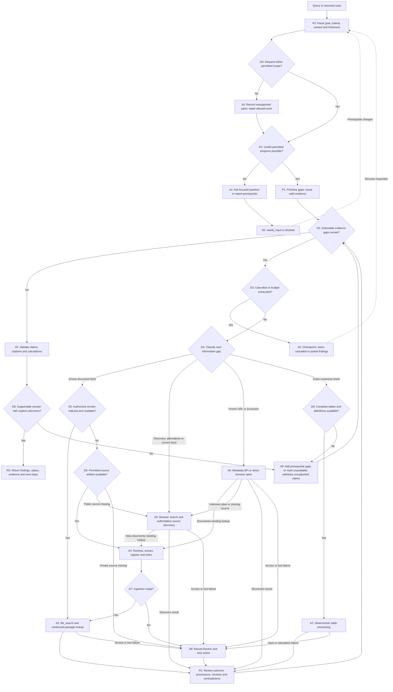

# Biofinder

A proposed agent for discovering biological datasets and investigating whether
they fit a research question. It combines web search, document lookup, and
reproducible metadata checks, returning cited recommendations and explicit unknowns.

The Python runtime plans bounded investigations, retrieves document and public
web evidence, runs exact table calculations, and returns quotations, provenance,
numeric checks, and unresolved questions. Try the six synthetic scenarios without
credentials or paid API calls. Live OpenAI and Brave Search adapters are opt-in.

- [Requirements specification](REQUIREMENTS_SPECIFICATION.md)
- [Six technical-support scenarios](TECHNICAL_SUPPORT_SCENARIOS.md)
- [Text-based agent decision tree](AGENT_DECISION_TREE.md)
- [Temporary context and safe tool handoffs](CONTEXT_MANAGEMENT_PLAN.md)
- [Cache strategies and invalidation](CACHE_STRATEGIES.md)
- [Tool-cost and support-workflow optimization](OPTIMIZATION_PLAN.md)
- [Tests and offline benchmarks](TESTING.md)

## Agent decision flow

The agent routes each **information gap** rather than committing an entire
conversation to one tool. Known document questions use `file_search`; discovery
and freshness questions use the browser. Known accessions can go directly to
metadata APIs or a browser open. Exact counts and joins use deterministic table
processing after definitions and complete inputs are available.

The node IDs below match the [text decision tree](AGENT_DECISION_TREE.md).
Ingestion means permitted retrieval, extraction, provenance registration, and
indexing. Budget and cancellation checks apply before every underlying tool call.



A zero-hit document search is reviewed at R1 for coverage, aliases, and indexing;
it is not proof that a fact is absent. Unavailable gaps remain explicit rather
than generating endless retries. New URLs or documents found by the browser
must be ingested before they can be searched with `file_search`.

The six complex support scenarios require both web and document evidence.
Simpler or document-only user requests can take a shorter path. Permission
boundaries, private search terms, tool availability, retry limits, result statuses,
and scenario-specific routes are detailed in the text tree and requirements.

## Run locally

Requires Python 3.10+. The only runtime dependency is `pypdf` for searchable PDFs.

```bash
python3 -m venv .venv
source .venv/bin/activate
python3 -m pip install -r requirements.txt
python3 agent_cli.py --scenario 1 --format markdown
```

Choose scenarios 1–6. They use synthetic documents, complete small tables, and
predefined model/search/HTTP responses through the real client and routing code.
No network connection or API key is needed. JSON output is the default; reports
label this mode `fixture`. Token usage in fixture responses is synthetic.

Exit code zero means the scoped investigation completed; two means partial,
blocked, cancelled, or more input needed. Scenarios 4 and 6 intentionally retain
unknowns. A completed investigation can still show that a dataset **fails** a
criterion: scenario 1 finds 18 donors behind 120 library rows, below a 30-donor
minimum. Completion does not certify scientific suitability or reuse permission.

## Optional live configuration

Copy the template locally and fill in your own configuration:

```bash
cp .env.example .env
```

Only `.env.example`, with empty credential fields, belongs in Git. `.env` and
other `.env.*` files are ignored. Injected environment variables take precedence
over the local file; loading it never evaluates shell expressions.

| Setting | Purpose |
| --- | --- |
| `OPENAI_API_KEY` | OpenAI credential, used only in live mode |
| `BIOFINDER_MODEL` | Model supporting Chat Completions JSON mode and `max_completion_tokens` |
| `BRAVE_SEARCH_API_KEY` | Brave public search credential; direct source opens do not need it |
| `BIOFINDER_ALLOWED_HOSTS` | Comma-separated allowed public source hosts, including required redirect hosts |
| `BIOFINDER_PUBLIC_TERMS` | Explicitly approved non-sensitive browser query terms |
| `BIOFINDER_REQUEST_LIMIT` | Total external HTTP request budget, default 30 |
| `BIOFINDER_MODEL_CALL_LIMIT` | Model attempt budget, default 8 |

For example, after configuring credentials locally:

```bash
python3 agent_cli.py --live \
  --query "Find public RNA-seq datasets for human melanoma" \
  --public-term "human melanoma RNA-seq public datasets" \
  --allowed-host www.ncbi.nlm.nih.gov --allow-model-context --format markdown
```

Add `--document study.md` and `--table samples.csv` for your own inputs. File stems
must be unique; they become the document/table names available to the planner.
Use `--reference https://...` to approve a specific public source URL. Document
lookup supports UTF-8 text/Markdown/JSON, CSV/TSV, and text extracted from PDFs.
Scanned PDFs require an OCR adapter and return a blocker. Limits are 25 MiB per
input, 200 PDF pages, and 100,000 rows per calculation input.

`--allow-model-context` explicitly enables sending case queries and retrieved
passages to the configured model provider. Browser search receives only approved
public terms. Source hosts and redirects are checked; public DNS resolution is
checked before retrieval. Machine network policy still applies. These checks do
not provide production DNS-rebinding isolation or replace an egress proxy.

## Runtime and integration

- `annotation.py`: `classify_query()` classifies the initial query using explicit
  intent, context, and transparent keyword rules. `BiofinderAgent.route_request()` follows the decision tree
  using explicit `if`/`elif`/`else` branches. `file_search_handle()` checks scope
  and readiness, tries one contextual lookup after a miss, and uses only approved
  public terms for a permitted browser fallback. Newly fetched documents pass
  ingestion before lookup; a second miss does not recurse into another web search.
- `workflow.py`: bounded model planning, evidence-gap execution, deferred
  calculation planning after definition lookup, in-memory checkpoints, exact
  quotation/citation validation, criteria comparisons, and partial findings.
- `api_client.py` and `browser.py`: injectable OpenAI Chat Completions and Brave
  Search clients, bounded public retrieval, explicit redirects, TLS, timeouts,
  retry/budget accounting, and sanitized failures.
- `table_processing.py`: exact distinct counts, unmatched identifiers, numeric
  baseline windows, one-to-one joins, and cross-tabulations. Calculations include
  input hashes and parameters; model-generated code is never executed.
- `cache.py`: bounded TTL/LRU caches for scoped search results, fetched documents,
  and calculations keyed by exact inputs. Currentness requests bypass public
  caches. Final answers are not cached.
- `runtime.py` and `agent_cli.py`: full investigation wiring and live/offline CLI.
- `integration.py`: local lexical `file_search` and ingestion adapters, plus the
  original single-gap CLI. Adapter protocols remain injectable.

The original single-gap document demonstration remains available:

```bash
python3 integration.py "What are the external request budgets?" \
  --document REQUIREMENTS_SPECIFICATION.md --document-only
```

This command returns evidence and an operation trace, without running a model or
the final investigation workflow; its retrieved evidence status remains `partial`.

Run all tests and the repeatable offline benchmark:

```bash
python3 -m unittest discover -s tests -v
python3 -m benchmarks.run --runs 30 --output /tmp/biofinder-benchmark.json
```

For application use, call `runtime.build_investigation()` with authorized inputs,
approved public terms, source policy, and explicit model-context approval. Then
call `investigation.run(query, requirements=...)`. Numeric criteria accept
`id`, `operation`, optional `column`, `field`, and `minimum`; absent matching
calculations remain unknown. Set `router.progress` for stage events, set
`router.context.cancelled` to stop, and use `run(..., resume=True)` with unchanged
query/requirements to resume in the same process. Budgets and deadlines are
retained on resume; the application controls any extension.

This is an initial runtime, not a production service. Live provider behavior has
not been exercised by the offline test suite. Local `file_search` is lexical,
not an OpenAI File Search/vector-store connector; browser retrieval does not run
JavaScript. Dedicated accession/metadata connectors, OCR, semantic claim
entailment, general adaptive replanning, durable storage, multi-user authorization,
and deployment controls remain future integrations. Exact quote support and a
copied calculation definition are mechanical checks, not a scientific or legal
review. Case state and caches are in memory and are not a multi-user security
boundary. No provider credentials are embedded.
