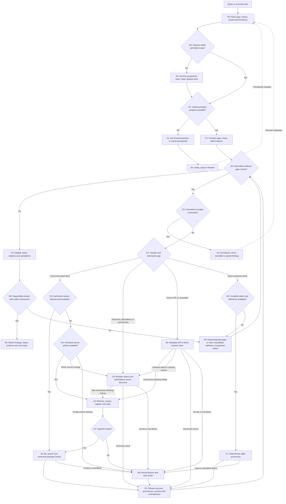

# Biofinder

A proposed agent for discovering biological datasets and investigating whether
they fit a research question. It combines web search, document lookup, and
reproducible metadata checks, returning cited recommendations and explicit unknowns.

This repository includes design documents and a Python starter for evidence-gap
routing. It is not yet a complete research agent: model-based planning, final
claim validation, production provider integrations, and the proposed caches are
not implemented.

- [Requirements specification](REQUIREMENTS_SPECIFICATION.md)
- [Six technical-support scenarios](TECHNICAL_SUPPORT_SCENARIOS.md)
- [Text-based agent decision tree](AGENT_DECISION_TREE.md)
- [Temporary context and safe tool handoffs](CONTEXT_MANAGEMENT_PLAN.md)
- [Cache strategies and invalidation](CACHE_STRATEGIES.md)
- [Tool-cost and support-workflow optimization](OPTIMIZATION_PLAN.md)

## Agent decision flow

The agent routes each **information gap** rather than committing an entire
conversation to one tool. Known document questions use `file_search`; discovery
and freshness questions use the browser. Known accessions can go directly to
metadata APIs or a browser open. Exact counts and joins use deterministic table
processing after definitions and complete inputs are available.

The node IDs below match the [text decision tree](AGENT_DECISION_TREE.md).
Ingestion means permitted retrieval, extraction, provenance registration, and
indexing. Budget and cancellation checks apply before every underlying tool call.



A zero-hit document search is reviewed at R1 for coverage, aliases, and indexing;
it is not proof that a fact is absent. Unavailable gaps remain explicit rather
than generating endless retries. New URLs or documents found by the browser
must be ingested before they can be searched with `file_search`.

The six complex support scenarios require both web and document evidence.
Simpler or document-only user requests can take a shorter path. Permission
boundaries, private search terms, tool availability, retry limits, result statuses,
and scenario-specific routes are detailed in the text tree and requirements.

## Python starter

Requires Python 3.10+; the starter and tests use only the standard library.

- `annotation.py`: `classify_query()` classifies the initial query using explicit
  intent, context, and transparent keyword rules. `BiofinderAgent.route_request()` follows the decision tree
  using explicit `if`/`elif`/`else` branches. `file_search_handle()` checks scope
  and readiness, tries one contextual lookup after a miss, and uses only approved
  public terms for a permitted browser fallback. Newly fetched documents pass
  ingestion before lookup; a second miss does not recurse into another web search.
- `integration.py`: entry point and adapter wiring, with a real local UTF-8
  Markdown/text lexical-search demonstration. It is not a semantic search service
  or PDF parser. Configure production tools through the protocols in `annotation.py`.

Run a document-only example:

```bash
python3 integration.py "What are the external request budgets?" \
  --document REQUIREMENTS_SPECIFICATION.md --document-only
```

Output is JSON containing status, route, cited evidence with line locations, and
an operation trace. Retrieved evidence is `partial` until a final claim-validation
stage exists. The CLI exits zero when evidence is retrieved, or two when input,
capabilities, or further investigation are needed. These exit codes do not certify
that a scientific question has been fully answered.

Run the tests:

```bash
python3 -m unittest discover -s tests -v
```

For an application integration, instantiate `BiofinderAgent` with authorized
`CaseContext` and real `FileSearch`, `Browser`, `Ingestor`, and optional
`TableProcessor` adapters, or inject a browser into `create_agent()`. Browser
requests are disabled in the CLI demo. No provider credentials are embedded.
Adapter names describe a contract, not a vendor SDK's actual method signatures.

Applications must supply authorization, approved public handoff terms/references,
source-host policy, and transport timeouts. Browser adapters must enforce DNS and
redirect policy before requests; the router's URL checks cannot replace network
controls. Accession-to-URL resolution and dedicated metadata connectors are future
integrations; the direct-source route currently accepts approved public URLs.
A case object is in-process state, not a multi-user security boundary or durable
checkpoint. Caches, OCR/PDF ingestion, a full multi-gap planner, model synthesis,
and numerical table operations are not provided by this starter.
